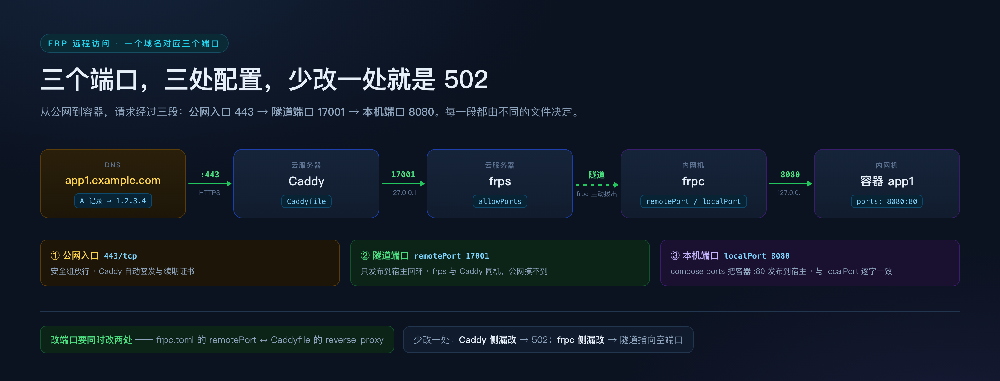

# 01 · 全链路原理与方案选型

> 这篇讲「为什么」。搭通之后再读也来得及，但先读能让后面每一步都变得理所当然：
> 你会知道每个端口为什么要开、Caddy 为什么不能省、改配置为什么会让隧道断几秒。
>
> 文中的 `${...}` 都来自 [README](README.md) §2 参数表。

---

## 1. 五跳拆解

把「浏览器打开 `https://app1.example.com`」拆成五跳，每一跳只有一个职责：

```
┌────────────────────────────────────────────────────────────────────────┐
│ ① DNS 解析                                                             │
│    app1.example.com ──A 记录──▶ ${SERVER_IP}                           │
│    职责：把名字翻译成云服务器地址。之后 DNS 不再参与。                 │
└───────────────────────────────┬────────────────────────────────────────┘
                                ▼
┌────────────────────────────────────────────────────────────────────────┐
│ ② 云服务器入口 + TLS 终止（Caddy，443/tcp）                            │
│    Caddy 认出 Host: app1.example.com → 反代 http://127.0.0.1:17001     │
│    职责：HTTPS 加解密、证书自动签发续期、按域名分流。                  │
│    它不关心后端是什么技术栈——只认「域名 → 本地端口」。                 │
└───────────────────────────────┬────────────────────────────────────────┘
                                ▼
┌────────────────────────────────────────────────────────────────────────┐
│ ③ frps 隧道入口（云服务器，127.0.0.1:17001）                           │
│    frps 早就和内网机上的 frpc 维持着一条控制连接。                     │
│    有连接进来 → 通过控制通道告诉 frpc「有活，开一条 work 连接」        │
│    职责：只做 TCP 字节搬运。它不知道、也不需要知道 HTTP 和域名。       │
└───────────────────────────────┬────────────────────────────────────────┘
                                ▼
┌────────────────────────────────────────────────────────────────────────┐
│ ④ frpc（内网机，主动拨出）                                             │
│    frpc 收到指令 → 主动连回 frps:7000 → 把字节转发到 127.0.0.1:8080    │
│    职责：把「隧道远端」接到「本机服务」。                              │
│    关键：它从不接受入站连接，所以不需要公网 IP、不需要端口映射。       │
└───────────────────────────────┬────────────────────────────────────────┘
                                ▼
┌────────────────────────────────────────────────────────────────────────┐
│ ⑤ Docker 容器（内网机上真正跑应用的地方）                              │
│    app1 容器监听 80，宿主发布成 127.0.0.1:8080                         │
│    职责：业务本身。对这层来说，请求只是「来自本机的普通 HTTP」。       │
└────────────────────────────────────────────────────────────────────────┘
```



**一句话记住分工**：
DNS 负责「找到云服务器」→ Caddy 负责「认域名 + 管证书」→ frps 负责「搬字节」→ frpc 负责「接回内网」→ Docker 负责「干活」。

---

## 2. 为什么 frpc 不需要公网 IP

这是整套方案能成立的根本原因，值得单独说清：

```
传统做法：外网 → 路由器端口映射 → 内网机器     ❌ 需要公网 IP + 路由器可控
本方案：  内网机器 → 主动拨出到 frps → 外网     ✅ 只需要能出网
```

frpc 启动时主动连 `frps:7000`，并**一直保持**这条控制连接。之后：

- 有外部连接进来，frps 通过**已有的**控制连接通知 frpc；
- frpc 再**主动拨出**一条新的 work 连接回 frps，专门搬运这条业务流量。

因为所有连接都是「从内向外」建立的，NAT 和防火墙天然放行。所以内网机换 Wi-Fi、
IP 变了、甚至用手机热点，链路都能自愈（frpc 会重连）。

> 代价：frpc 那台机器必须能访问到 frps 的 `bindPort`（出站放行即可）。
> 这也是为什么「公司内网禁用外网」的环境里，这条路也常常能走通。

---

## 3. 方案选型：三种让域名生效的做法

同样的目标，有三种接法。选错会让后面每次加域名都很痛苦，所以先讲清楚取舍。

### 方案 A：frps 原生 vhost（http / https 代理）

```
浏览器 → ${SERVER_IP}:80（frps 的 vhostHTTPPort）
       → frps 按 Host 头匹配 customDomains
       → 隧道 → frpc → 容器
```

```toml
# frps.toml
vhostHTTPPort  = 80
vhostHTTPSPort = 443
```

```toml
# frpc.toml
[[proxies]]
name = "app1"
type = "http"
localPort = 8080
customDomains = ["app1.example.com"]
```

| 优点 | 缺点 |
|---|---|
| 少一跳，没 Caddy | **证书管理笨**：frps 的 TLS 证书是全局一份，多域名要重签 SAN 证书 |
| frp 原生支持 | `80/443` 被 frps 独占，别的服务（含 Caddy）抢不到 |
| 配置项少 | 改域名要动 frps.toml（frps 无热加载，得重启，**全隧道瞬断**） |

### 方案 B：Caddy 反代 + TCP 隧道（**推荐这个**）

```
浏览器 → ${SERVER_IP}:443（Caddy）
       → 按域名反代 127.0.0.1:17001
       → frps（该端口只是普通 TCP）→ frpc → 容器
```

```toml
# frpc.toml：注意是 tcp，不是 http
[[proxies]]
name = "app1"
type = "tcp"
localPort  = 8080
remotePort = 17001
```

```caddyfile
# Caddyfile
app1.${DOMAIN_ROOT} {
    encode zstd gzip
    reverse_proxy 127.0.0.1:17001
}
```

| 优点 | 缺点 |
|---|---|
| **证书全自动**：Caddy 内置 ACME，签发 + 续期零配置 | 多一跳（可忽略，都是回环/本机） |
| **加域名不动 frps**：只改 Caddyfile + `caddy reload`，隧道不断 | 每个应用占一个 `remotePort` |
| frps 只暴露 `7000`，**不碰 80/443**，攻击面最小 | 需要多维护一个 Caddy |
| 后端可以是任何协议（HTTP/WS/gRPC/甚至原生 TCP） | |

### 方案 C：frps 直接收 443 + 自带证书

```
浏览器 → ${SERVER_IP}:443（frps 的 vhostHTTPSPort，证书由 frps 配置）
```

本质是方案 A 的 HTTPS 版。除非你坚决不装 Caddy，否则不推荐——证书要手动轮换，
而 Caddy 免费替你做这件事。

### 决策矩阵

| 维度 | A（frp vhost） | **B（Caddy + TCP）** | C（frp 直收 443） |
|---|---|---|---|
| HTTPS 证书 | 手动 / SAN 重签 | **自动** | 手动 |
| 加域名是否断隧道 | 会（重启 frps） | **不会** | 会 |
| frps 暴露端口 | 80 + 443 + 7000 | **仅 7000** | 443 + 7000 |
| 后端协议自由度 | 限 http/https | **任意** | 限 https |
| 组件数量 | 1 | 2 | 1 |
| 适合 | 单应用、临时 | **多应用、长期** | 不推荐 |

**结论：默认走 B。** 只有「就一个应用、且完全不想装 Caddy」时才考虑 A。

---

## 4. 每一跳的职责边界（排错靠这个）

| 跳 | 只负责 | 不负责 | 断了看什么 |
|---|---|---|---|
| DNS | 名字 → IP | 端口、TLS | `dig app1.${DOMAIN_ROOT}` |
| Caddy | TLS + 按 Host 分流 | 后端是否活着 | `docker logs caddy` |
| frps | TCP 搬运 + 隧道注册状态 | 域名、HTTP 语义 | Dashboard `:7500`、proxy 是否 online |
| frpc | 隧道 + 接本机服务 | 公网、证书 | frpc 日志、`start error` |
| Docker | 业务本身 | 宿主端口发布 | `docker ps`、`docker logs <svc>` |

**这张表就是 [05 故障排查](05-故障排查.md) 的故障树骨架**——
排错时先问「哪一跳断了」，而不是从头发呆。

---

## 5. frp 概念对照表

| frp 概念 | 在这里叫 | 说明 |
|---|---|---|
| `bindPort` | `${FRPS_BIND_PORT}` = 7000 | frpc 连 frps 用，**唯一必须公网开放**的 frp 端口 |
| `remotePort` | `17001` | 云服务器上该隧道对外监听的端口（本例只给 Caddy 访问） |
| `localPort` / `localIP` | `127.0.0.1:8080` | **frpc 所在机器**能访问到的地址（见 README §4 硬规则 1） |
| `user`（配置档前缀） | `inner` | 注册到 frps 的名字会变成 `inner.app1`，**只影响面板显示，不影响访问** |
| `vhostHTTPPort` | 这里**不用** | 方案 A/B 的分水岭：用了它就等于选了方案 A |
| `allowPorts` | 建议配 | 限制 `remotePort` 只能是 `17000–17199`，防止误开端口 |
| `proxyBindAddr` | 建议 `127.0.0.1` | 让隧道端口只绑回环，**只能 Caddy 访问**，公网摸不到 |

---

## 6. 安全模型

整套方案的暴露面要收敛到最小：

| 端口 | 谁在听 | 对公网 | 理由 |
|---|---|---|---|
| `22` | sshd | ✅（建议限 IP） | 运维入口 |
| `80` | Caddy | ✅ | ACME HTTP-01 挑战 + 301 跳 443 |
| `443` | Caddy | ✅ | 业务入口 |
| `7000` | frps | ✅ | frpc 必须连得上 |
| `7500` | frps Dashboard | ❌ **仅回环** | 只有 Basic Auth，暴露=送人 |
| `17000–17999` | frps 隧道端口 | ❌ **仅回环** | 只给 Caddy 用；`proxyBindAddr=127.0.0.1` 后公网天然不可达 |

另外三条：

1. `auth.token` 用 `openssl rand -hex 16` 生成，**不要用默认值**；
2. frpc 连 frps 开 `transport.tls.enable = true`（加密控制通道）；
3. Dashboard 与隧道端口远程查看一律走 `ssh -L`，不要开公网。

---

## 7. 这套方案不解决什么

诚实列出边界，避免误用：

1. **不解决「云服务器 IP 被封」**——国内未备案域名访问 80/443 会被拦，这是合规问题，不是技术问题。
2. **不解决「内网机断电/断网」**——隧道会断，frpc 恢复后自动重连，但应用本身停了就是停了。
3. **不提供高可用**——云服务器是单点，它挂了整条链断。要 HA 得加第二台 + DNS 轮询，超出这篇的范围。
4. **不替代 VPN**——这是「把特定端口暴露出去」，不是「让远程设备进内网」。要进内网请用 WireGuard/Tailscale。
5. **frps 重启会让所有隧道瞬断数秒**——frp 无热加载，这是协议层的限制。
