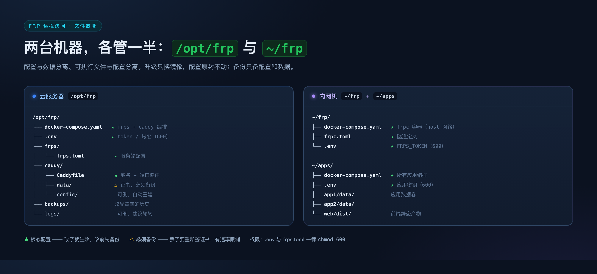

# 02 · 目录结构：文件摆在哪

> 动手之前先看一眼这张地图：两台机器上各自要建哪些目录、每个文件管什么、
> 哪些丢了要重做、哪些随时可以删。
>
> 配置内容怎么写在 [03](03-部署手册.md)，变量名见 [README](README.md) §2。

---

## 1. 三台机器，各管什么

| 代号 | 机器 | 有公网 IP | 装什么 | 用到的根目录 |
|---|---|---|---|---|
| **A** | 云服务器 | ✅ | frps、Caddy、sshd | `${DEPLOY_ROOT}` = `/opt/frp` |
| **B** | 内网机 | ❌（NAT 后） | frpc、Docker 应用 | `~/frp` + `~/apps` |
| **C** | 本地开发机（可选） | — | SSH 客户端；本地先验证一遍 | 任意 |

**设计原则**：**配置与数据分离、可执行文件与配置分离**。
升级 frp 只换二进制/镜像，配置原封不动；备份只备配置和数据，不备日志与可重建物。

---



## 2. 云服务器（A）目录结构

```
${DEPLOY_ROOT}/                          # /opt/frp，以下所有路径都相对它
├── docker-compose.yaml                  # ★ 编排：frps + caddy 两个服务
├── .env                                 # ★ 真实值（token/域名），chmod 600，不进 git
├── .gitignore                           #   忽略 .env / logs/ / caddy/data/
│
├── frps/                                # ── frp 服务端 ──
│   ├── frps.toml                        # ★ 服务端配置：bindPort / token / allowPorts
│   └── README.local.md                  #   你的本地备注：这台机器谁在用、改过什么
│
├── caddy/                               # ── 反向代理 + 自动 TLS ──
│   ├── Caddyfile                        # ★ 路由表：域名 → 127.0.0.1:17xxx
│   ├── data/                            # ⚠️ 证书与 ACME 账号，**必须备份**
│   └── config/                          #   运行时配置缓存，可删（Caddy 会重建）
│
├── backups/                             # ★ 配置备份（手动或 Agent 自动写入）
│   ├── frps.toml.20261023-101500.bak
│   └── Caddyfile.20261023-101500.bak
│
└── logs/                                #   可删；建议配 logrotate
    ├── frps.log
    └── caddy.log
```

### 每个文件的职责

| 路径 | 谁写 | 权限 | 进 git？ | 作用 |
|---|---|---|---|---|
| `docker-compose.yaml` | 你 | `644` | ✅ 可以 | 定义 frps + caddy 的镜像、端口、卷、网络 |
| `.env` | 你 | **`600`** | ❌ **绝不** | 存 `FRPS_TOKEN`、`DOMAIN_ROOT` 等，被 compose 引用 |
| `frps/frps.toml` | 你 / 自动化脚本 | `644` | ✅ 可以 | frps 启动时**只读一次**；改了必须重启 |
| `caddy/Caddyfile` | 你 | `644` | ✅ 可以 | 域名路由；改完 `caddy reload` 即可，**不中断隧道** |
| `caddy/data/` | Caddy | `700` | ❌ | 证书私钥 + ACME 账户；**删了会重新签发**（有速率限制，且短暂不可用） |
| `caddy/config/` | Caddy | `700` | ❌ | 自动生成的运行时 JSON，可随时删 |
| `backups/` | 你 / Agent | `700` | ❌ | 回滚用；建议保留最近 10 份 |
| `logs/` | Docker | `755` | ❌ | 排查用；占空间，需轮转 |

> **为什么 frps 配置放 `/opt/frp` 而不是 `/etc/frp`？**
> 因为整套东西由 `docker-compose.yaml` 编排，配置和编排放同一棵树里，
> 迁移时 `rsync /opt/frp` 一把梭。用 systemd 跑二进制时，`/etc/frp` 更符合 FHS 惯例——
> 两种都行，**关键是别同一套配置放两个地方**。

---

## 3. 内网机（B）目录结构

```
~/                                        # 家目录
├── frp/                                  # ── 隧道客户端（Docker 托管）──
│   ├── docker-compose.yaml               # ★ frpc 容器（network_mode: host）
│   ├── frpc.toml                         # ★ 客户端配置：serverAddr / token / [[proxies]]
│   └── .env                              # ★ FRPS_TOKEN，chmod 600，不进 git
│
├── apps/                                 # ── 被穿透的 Docker 应用 ──
│   ├── docker-compose.yaml               # ★ 所有应用编排（端口发布在这里）
│   ├── .env                              # ★ 应用自己的密钥，chmod 600
│   ├── app1/
│   │   └── data/                         #   应用数据卷
│   ├── app2/
│   │   └── data/
│   └── web/
│       └── dist/                         #   前端静态产物
│
└── .ssh/
    └── config                            #   INNER_SSH 别名定义在这（本机侧）
```

### 关键点：`localPort` 到容器端口的映射

内网机上有三层地址，**填错一层就是 502**：

```
容器内监听            宿主机发布               frpc 要填的 localPort
app1:80        →      127.0.0.1:8080    →      8080
                      （docker-compose 的 ports 决定）
```

| 你在 `frpc.toml` 里填 | 含义 | 什么时候对 |
|---|---|---|
| `localIP = "127.0.0.1"`, `localPort = 8080` | 宿主发布的端口 | ✅ 默认（frpc 用 `network_mode: host`） |
| `localIP = "app1"`, `localPort = 80` | Docker 服务名 | ⚠️ 仅当 frpc 也在**同一个** Docker 网络里（本方案不用） |
| `localIP = "127.0.0.1"`, `localPort = 80` | 宿主 80 端口 | ❌ 除非应用确实发布到了 80 |

> **frpc 必须 `network_mode: host`。** 换成 bridge 后，容器里的 `127.0.0.1`
> 是它自己的回环，连不到宿主上的应用端口，表现为「隧道通但 502 / connection refused」。
> 这条对应 [README.md](README.md) §4 硬规则 1，是最高频的故障源。
>
> frpc 日志不落盘，看 `docker compose logs -f frpc`（这里的配置是 `log.to = "console"`）。

---

## 4. 备份与恢复清单

**必须备份**（丢了要重签/重配）：

| 路径 | 为什么 |
|---|---|
| `A:${DEPLOY_ROOT}/caddy/data/` | 证书私钥 + ACME 账户；丢了要重新签发，有速率限制 |
| `A:${DEPLOY_ROOT}/frps/frps.toml` | 服务端配置 |
| `A:${DEPLOY_ROOT}/caddy/Caddyfile` | 域名路由表（最容易忘） |
| `A:${DEPLOY_ROOT}/.env` | token（丢了 frpc 全连不上） |
| `B:~/frp/frpc.toml` | 所有隧道定义 |
| `B:~/apps/docker-compose.yaml` + 各 `data/` | 应用本身 |

**不用备份**（可重建）：

- `logs/`、`caddy/config/`、`docker-compose.yaml`（在 git 里）、`build/`、`web/dist/`

**一条命令备份 A 机配置**（不含证书私钥，需要单独处理）：

```bash
ssh <云服务器别名> "tar czf - -C ${DEPLOY_ROOT} docker-compose.yaml .env frps/frps.toml caddy/Caddyfile" \
  > frp-server-config-$(date +%Y%m%d).tgz
```

> `caddy/data/` 里有私钥，建议 `rsync -a` 到加密盘，而不是随手 `tar` 到桌面。

---

## 5. 一次配置变更的完整路径

以「新增 `app3.${DOMAIN_ROOT}`」为例，文件是按这个顺序动的：

```
① B 机 ~/apps/docker-compose.yaml      加 app3 服务 + ports: "127.0.0.1:9010:80"
② B 机 ~/frp/frpc.toml                 加一段 [[proxies]]：localPort=9010, remotePort=17013
③ B 机 cd ~/frp && docker compose up -d frpc   隧道通，frps 上能看到 inner.app3
④ A 机 ${DEPLOY_ROOT}/caddy/Caddyfile  加一个站点块：app3.domain → 127.0.0.1:17013
⑤ A 机 caddy reload                    证书自动签，**frps 不用动，隧道不断**
⑥ DNS 加 app3 的 A 记录（或泛解析已覆盖）
⑦ 验收：curl -I https://app3.${DOMAIN_ROOT}
```

注意第 ③ 步和第 ④ 步的**顺序可以互换**，但**都必须做**：
少了 ②③ 是 502，少了 ④ 是 404/握手失败。

完整 checklist 见 [04 新增应用](04-新增应用.md)。
