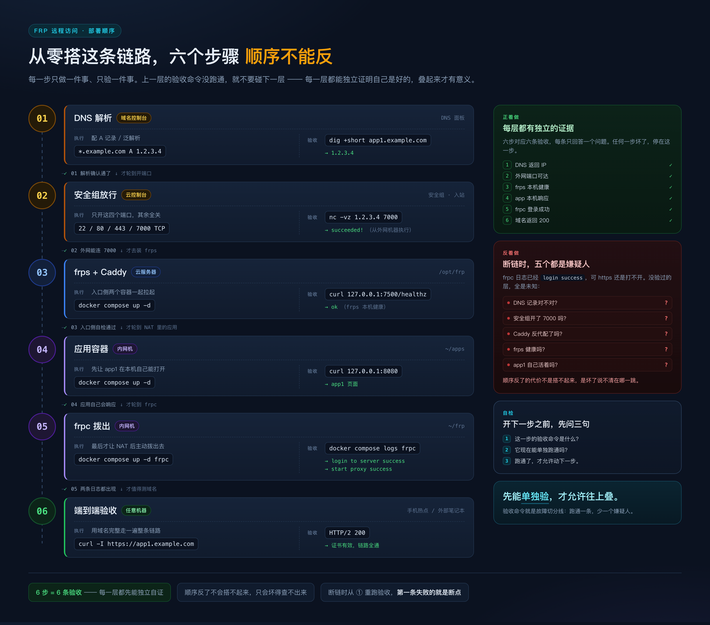

# 03 · 从零部署：跟着做就能通

> 这篇是主线。从上到下照着做，每一步都给出「怎么确认这步真的成了」的命令——
> 没确认成功就别往下走，否则出了问题你分不清是哪一层。
>
> 不需要先读其他篇，但建议先扫一眼 [02 目录结构](02-目录结构.md)，知道文件该建在哪。

> **占位符**：`${...}` 全是假值。配置文件里的手工替换成真实值（程序不展开它）；shell 命令里的先 `export`，下面的命令即可原样复制执行。

```bash
export DOMAIN_ROOT=example.com                       # 主域名，另配泛解析 *.example.com
export SERVER_IP=1.2.3.4                             # 云服务器公网 IP
export FRPS_TOKEN="$(openssl rand -hex 16)"          # frps / frpc 共享密钥，两边必须一致
export FRPS_DASH_PASSWORD="$(openssl rand -hex 8)"   # frps 面板 admin 的密码
export FRPC_DASH_PASSWORD="$(openssl rand -hex 8)"   # frpc 本机面板 admin 的密码
export DEPLOY_ROOT=/opt/frp                          # 云服务器部署根目录
export INNER_LAN_IP=192.168.1.50                 # 内网机局域网 IP，仅反向验证用
```

---

## 0. 部署总览

| 机器 | 装什么 | 对外监听 | 谁发起连接 |
|---|---|---|---|
| **云服务器**（有公网 IP） | Docker + Compose；容器 `frps`、`caddy` | `22`、`80`、`443`、`7000` | 被动：等 frpc 拨入、等浏览器访问 |
| **内网机**（NAT 后） | Docker + Compose；容器 `frpc` + 应用容器 | 无入站需求 | 主动：frpc 向 `${SERVER_IP}:7000` 拨出 |
| **本地开发机** | `dig`/`curl`/`ssh`/`nc` | — | 只做验收 |

### 0.1 端口与域名分配（跟着做就用这一套）

| 域名 | Caddy 反代目标 | frps `remotePort` | 内网机 `localPort` | 应用 |
|---|---|---|---|---|
| `app1.${DOMAIN_ROOT}` | `127.0.0.1:17001` | `17001` | `127.0.0.1:8080` | `app1`（容器 80） |
| `app2.${DOMAIN_ROOT}` | `127.0.0.1:17002` | `17002` | `127.0.0.1:9000` | `app2`（容器 80） |
| `web.${DOMAIN_ROOT}` | `127.0.0.1:17003` | `17003` | `127.0.0.1:3000` | `web`（容器 80） |

端口段：`7000` frps 接入；`7500` frps 面板（仅回环）；`17000–17099` HTTP 类应用；`17100–17199` 纯 TCP 应用。

### 0.2 部署顺序

顺序不能反：**每一层先能独立验证，才允许叠下一层**；反过来做（frpc 先跑起来再查 Caddy），断链时你分不清是哪一跳。



```
① 云服务器：建目录 + docker-compose.yaml    → docker compose config -q 无输出
② 云服务器：frps.toml → up -d frps          → nc ${SERVER_IP} 7000 通 + /healthz 200
③ 云服务器：Caddyfile → up -d caddy         → https 返回 502（TLS 通了、后端还没通，正常）
④ 内网机：应用容器 up -d                  → curl 127.0.0.1:8080 返回 200
⑤ 内网机：frpc.toml → up -d frpc          → login success + 每条 proxy start success
⑥ 端到端：curl -I https://app1.${DOMAIN_ROOT} → HTTP/2 200
```

---

## 1. 前置准备

### 1.1 域名解析

| 记录 | 名称 | 值 | 用途 |
|---|---|---|---|
| A | `${DOMAIN_ROOT}`（@） | `${SERVER_IP}` | 主域（建议保留） |
| A | `*.${DOMAIN_ROOT}`（泛解析） | `${SERVER_IP}` | `app1.` `app2.` `web.` 共用 |

**泛解析 ≠ 泛域名证书**：泛解析只把任意子域名指向同一台机器；证书由 Caddy 按 Host 逐个申请，走 HTTP-01 / TLS-ALPN-01，不需要 DNS API，但 **80/443 必须公网可达**。

```bash
dig +short app1.${DOMAIN_ROOT}   # 期望：${SERVER_IP}；查不到先等 TTL，别往下走
```
后面所有证书申请都会因解析未生效而报 `no valid A records found`。

### 1.2 备案与安全组

服务器在中国大陆时，未备案域名的 80/443 会被云厂商拦截：DNS 正常、安全组正常、Caddy 也起来了，外部访问却超时或返回拦截页。**先完成 ICP 备案**，这是唯一不能靠改配置绕过的前置条件。境外服务器跳过。

| 端口 | 协议 | 来源 | 为什么 |
|---|---|---|---|
| `22` | TCP | 你的出口 IP/32 | SSH 管理 |
| `80` | TCP | `0.0.0.0/0` | ACME 验证 + HTTP→HTTPS 跳转 |
| `443` | TCP | `0.0.0.0/0` | 业务唯一入口 |
| `7000` | TCP | `0.0.0.0/0`（出口 IP 固定可收窄） | frpc 拨入 |

**`7500` 和 `17000–17199` 一律不进安全组**：前者是管理面板，后者是隧道出口，只该被同机 Caddy 访问。家宽 IP 通常动态，所以 7000 全网放行，安全性交给 token + TLS。注意 **Docker 发布的端口会绕过 ufw**（走 `DOCKER-USER` 链），主机防火墙只管非容器进程。

```bash
# 在内网机 / 本地执行；本机连本机测不出安全组
nc -vz ${SERVER_IP} 7000    # 期望：succeeded!
nc -vz ${SERVER_IP} 443     # 期望：succeeded!
curl -m 3 -sS http://${SERVER_IP}:7500/healthz   # 期望：连接失败；返回 200 说明端口外露
```

### 1.3 内网机安装 Docker

```bash
curl -fsSL https://get.docker.com | sudo sh
sudo usermod -aG docker "$USER"              # 重新登录后免 sudo
docker --version && docker compose version    # 期望：Docker version 2x.x.x / v2.x.x
docker run --rm alpine:3 echo ok              # 期望：ok
```

**Windows 用 WSL2 时**，Docker Desktop 的 `network_mode: host` 语义与 Linux 不同（容器内 `127.0.0.1` 不是宿主回环），第 5、6 节的写法会失效：把 frpc 二进制直接跑在 WSL2 里，或在 WSL2 内装 Docker Engine。这篇按 Linux 写。

---

## 2. 云服务器：目录初始化

```bash
sudo mkdir -p "${DEPLOY_ROOT}"/{frps,caddy/data,caddy/config}
sudo chown -R "$USER": "${DEPLOY_ROOT}"
chmod 700 "${DEPLOY_ROOT}" "${DEPLOY_ROOT}/caddy/data"
touch "${DEPLOY_ROOT}/frps/frps.toml" && chmod 600 "${DEPLOY_ROOT}/frps/frps.toml"
```

### 2.1 docker-compose.yaml

```yaml
# ${DEPLOY_ROOT}/docker-compose.yaml
name: frp-gateway

services:
  frps:
    image: fatedier/frps:v0.71.0
    container_name: frps
    restart: unless-stopped
    command: ["-c", "/etc/frp/frps.toml"]
    volumes:
      - ./frps/frps.toml:/etc/frp/frps.toml:ro
    ports:
      # ① 公网入口：安全组放行 7000，这里必须绑 0.0.0.0
      - "7000:7000"
      # ② 面板：只发布到宿主回环，拦住外部的是这一行左边的 127.0.0.1
      - "127.0.0.1:7500:7500"
      # ③ 隧道出口段：remotePort 在 frps 容器内监听，宿主上的 Caddy 要访问
      #    127.0.0.1:17xxx，必须把这一段发布到宿主回环
      - "127.0.0.1:17000-17099:17000-17099"

  caddy:
    image: caddy:2-alpine        # 生产可固定到具体 tag / digest
    container_name: caddy
    restart: unless-stopped
    # 必须 host 网络：Caddy 直连 80/443，并按「回环即边界」用 127.0.0.1:<remotePort>
    # 反代 frps 隧道口。放 bridge 网络时 127.0.0.1 会变成它自己的容器回环，
    # 只能改用容器名，等于拆掉这条约束。
    network_mode: host
    volumes:
      - ./caddy/Caddyfile:/etc/caddy/Caddyfile:ro
      - ./caddy/data:/data        # 证书持久化，否则每次重启重签
      - ./caddy/config:/config
```

三个必须理解的点：

- **`7500` 的安全性写在 `ports` 左半边**（Docker 只监听宿主回环），而容器内 frps 反而必须监 `0.0.0.0`（第 3 节）——两者不矛盾。
- **`17000–17099` 一次发布 100 个端口**是刻意的：新增应用不必再改 compose，只需改 Caddyfile 与 frpc.toml 两处。想收紧就写 `127.0.0.1:17001-17010:...`，代价是超范围要重建 frps、所有隧道瞬断。
- `caddy` 不能再写 `ports`：host 网络下它直接占用宿主 80/443/2019。

```bash
cd "${DEPLOY_ROOT}"
docker compose config -q           # 期望：无输出（有输出就是语法错）
docker compose config --services   # 期望：两行 frps / caddy
```

---

## 3. frps.toml 完整模板

```toml
# ${DEPLOY_ROOT}/frps/frps.toml  （chmod 600，文件内有 token）
# frp v0.71.0 TOML 格式。没有热加载：改完必须重启 frps，所有隧道瞬断几秒。
bindAddr = "0.0.0.0"
bindPort = 7000
# 容器里只能绑 0.0.0.0：Docker 端口发布从容器网卡进来，绑回环宿主完全连不上。
# 访问控制在编排的 ports 里（7000 公网、其余回环）。

# ── 认证：frpc 必须填一模一样的 token ─────────────────────────
auth.method = "token"
auth.token = "${FRPS_TOKEN}"
# token 不想落在配置里（要提交进 Git）就换成下面两行（与 auth.token 互斥）：
# auth.tokenSource.type = "file"
# auth.tokenSource.file.path = "/etc/frp/token"

# ── 端口白名单 ───────────────────────────────────────────────
allowPorts = [
  { start = 17000, end = 17199 },
]
# 不配这项，任何拿到 token 的 frpc 都能申请 22/443 这类端口，而容器默认
# 以 root 运行 —— 真实的越权面。分段含义见 0.1 节。

# ── 管理面板 / Prometheus ────────────────────────────────────
webServer.addr = "0.0.0.0"
webServer.port = 7500
webServer.user = "admin"
webServer.password = "${FRPS_DASH_PASSWORD}"
enablePrometheus = true
# 最容易踩的坑，原因与修复见文末坑表第 1 条。直接跑在宿主（非容器）时
# 应改回 "127.0.0.1"，靠 SSH 隧道访问：ssh -N -L 7500:127.0.0.1:7500 user@${SERVER_IP}

# ── 传输与日志 ───────────────────────────────────────────────
transport.tls.force = true     # 只接受 TLS。frpc 侧 enable 自 v0.50 起默认 true
transport.maxPoolCount = 5

log.to = "console"             # 进 stdout，用 docker compose logs 看
log.level = "info"
log.maxDays = 7
```

**不设 `vhostHTTPPort` / `vhostHTTPSPort`**（默认 0 即关闭）：TLS 在 Caddy 终接、Host 路由在 Caddy 做，frps 只做纯 TCP 转发；一旦打开，frps 会去抢 80/443，和 Caddy 冲突。

### 验证

```bash
cd "${DEPLOY_ROOT}"
# 1) 语法（不用启动容器）→ 期望：frps: the configuration file /etc/frp/frps.toml syntax is ok
docker run --rm -v "$PWD/frps/frps.toml:/etc/frp/frps.toml:ro" \
  fatedier/frps:v0.71.0 verify -c /etc/frp/frps.toml
# 2) 启动 → 期望：docker compose ps 里 frps 是 running
docker compose up -d frps && docker compose ps
# 3) 关键日志 → 期望：frps tcp listen on 0.0.0.0:7000 / dashboard listen on 0.0.0.0:7500
docker compose logs frps | grep -E "frps tcp listen|dashboard listen"
# 4) 回环健康检查 → 期望 200；空回复 / Connection reset 说明 addr 还是 127.0.0.1
curl -sS -o /dev/null -w '%{http_code}\n' http://127.0.0.1:7500/healthz
# 5) 公网端口（在内网机上）→ 期望 succeeded!
nc -vz ${SERVER_IP} 7000
```

---

## 4. Caddyfile 完整模板

```caddyfile
# ${DEPLOY_ROOT}/caddy/Caddyfile
# 一个站点块 = 一个域名。新增应用复制一块，改域名和 170xx 端口。

{
	email admin@${DOMAIN_ROOT}     # 证书账户邮箱，Let's Encrypt 发到期通知用
	# 联调先开 staging CA，避免失败验证撞速率限制；能签出证书后注释掉这行
	# acme_ca https://acme-staging-v02.api.letsencrypt.org/directory
	log {                          # 访问日志走 stdout，docker compose logs -f caddy 直接看
		output stdout
	}
}

# ── 应用 1：app1 → frps 隧道口 17001 ──
app1.${DOMAIN_ROOT} {
	encode zstd gzip
	reverse_proxy 127.0.0.1:17001
}

app2.${DOMAIN_ROOT} {
	encode zstd gzip
	reverse_proxy 127.0.0.1:17002
}

web.${DOMAIN_ROOT} {
	encode zstd gzip
	reverse_proxy 127.0.0.1:17003
}
```

两点说明：**反代目标写 `127.0.0.1:<remotePort>`，与 frpc.toml 的 `remotePort` 一一对应**（0.1 节那张表），绝不写容器名；WebSocket / SSE 无需额外配置。**TLS 全自动**——域名指向本机 + 80/443 可达即签发并续期，`./caddy/data` 就是凭证库，不需要 certbot；admin 接口默认 `localhost:2019`（host 网络下即宿主回环），**不要改成 0.0.0.0**。`${...}` 是文档占位符，Caddy 自身的环境变量语法是 `{$VAR}`，想从 compose 注入就改成 `{$APP1_HOST}` 并加 `environment`。

### 验证

```bash
cd "${DEPLOY_ROOT}"
docker compose up -d caddy
# 期望：Valid configuration
docker compose exec -T caddy caddy validate --config /etc/caddy/Caddyfile --adapter caddyfile
# 期望：certificate obtained successfully。出现 no valid A records found /
# connection refused 说明 DNS 或 80 端口有问题：先修再重启，反复重启会撞
# Let's Encrypt 的失败验证速率限制
docker compose logs -f caddy | grep -Ei "obtained|error"
# 期望：502。此时 frpc 还没起、127.0.0.1:17001 无人监听 —— 这正是本步成功的样子：
# TLS 通了、Host 路由对了、上游还没通。拿到超时 / 证书错误 / 404 才说明没过
curl -sS -o /dev/null -w '%{http_code}\n' https://app1.${DOMAIN_ROOT}
# 期望：HTTP/1.1 308 Permanent Redirect + Location: https://app1.${DOMAIN_ROOT}/
curl -sSI http://app1.${DOMAIN_ROOT} | head -3
```

---

## 5. 内网机：frpc.toml

frpc 用 `network_mode: host` 跑，所以 `localIP = "127.0.0.1"` 指的就是内网机宿主回环，直接命中第 6 节应用 compose 发布出来的端口。

```toml
# ~/frp/frpc.toml  （chmod 600）· frp v0.71.0 TOML 格式
serverAddr = "${SERVER_IP}"
serverPort = 7000
# user 是命名空间：所有 proxy 在 frps 上变成 {user}.{name}（面板显示 inner.app1）。
# 多客户端共用一个 frps 时，前缀避免重名互顶。
user = "inner"

auth.method = "token"
auth.token = "${FRPS_TOKEN}"

# 默认 true：首次登录失败就退进程，被 restart 策略反复拉起并指数退避。
# 设 false 让进程内重试；代价是 token 填错时只在日志里刷 login fail，不退出。
loginFailExit = false

transport.protocol = "tcp"
transport.tls.enable = true    # v0.50 起默认 true，显式写出与 frps 的 tls.force 对齐
transport.poolCount = 5

log.to = "console"
log.level = "info"

# 本机管理接口：只绑内网机回环，排查时 curl 127.0.0.1:7400 用。
# 不要发布到公网——它没有 TLS，只有单账号 Basic Auth。
webServer.addr = "127.0.0.1"
webServer.port = 7400
webServer.user = "admin"
webServer.password = "${FRPC_DASH_PASSWORD}"

# ── 三条隧道：remotePort ↔ Caddyfile，localPort ↔ 应用 compose 的宿主端口 ──
[[proxies]]
name = "app1"
type = "tcp"
localIP = "127.0.0.1"
localPort = 8080
remotePort = 17001
[[proxies]]
name = "app2"
type = "tcp"
localIP = "127.0.0.1"
localPort = 9000
remotePort = 17002
[[proxies]]
name = "web"
type = "tcp"
localIP = "127.0.0.1"
localPort = 3000
remotePort = 17003
```

```yaml
# ~/frp/docker-compose.yaml
name: frpc

services:
  frpc:
    image: fatedier/frpc:v0.71.0
    container_name: frpc
    restart: unless-stopped
    command: ["-c", "/etc/frp/frpc.toml"]
    # 必须 host 网络：否则容器里的 127.0.0.1 是容器自身回环，连不到宿主上的应用端口
    network_mode: host
    volumes:
      - ./frpc.toml:/etc/frp/frpc.toml:ro
```

### 验证

```bash
cd ~/frp && docker compose up -d frpc
# 期望：login to server success, get run id [xxxxxxxx]
#       [inner.app1] start proxy success（app2 / web 各一行）
docker compose logs frpc | grep -E "login to server success|start proxy success"
```

`start error` 表示 frps 拒绝该 proxy：`remotePort` 被占用，或超出 `allowPorts` 范围，日志里带具体原因。

---

## 6. 内网机：应用容器与端口发布

```yaml
# ~/apps/docker-compose.yaml
name: apps

services:
  app1:
    image: nginx:alpine
    restart: unless-stopped
    ports:
      # 左边绑 127.0.0.1：只有本机能连。frpc（host 网络）可访问，
      # 同 Wi-Fi 其他设备不能 —— 对外入口统一走 443，端口不裸奔
      - "127.0.0.1:8080:80"
  app2:
    image: httpd:alpine
    restart: unless-stopped
    ports:
      - "127.0.0.1:9000:80"
  web:
    image: nginx:alpine
    restart: unless-stopped
    ports:
      - "127.0.0.1:3000:80"   # 换镜像时右侧改成容器内实际监听端口
```

端口发布四条规则：**默认 `127.0.0.1:宿主端口:容器端口`**（左边写 `0.0.0.0` 或省略等于暴露给整个内网）；**左侧宿主端口 = frpc.toml 的 `localPort`**，逐字一致；**右侧是容器内监听端口**（nginx 80、node 3000），与镜像绑定，别照抄；**应用容器不要用 `network_mode: host`**，会绕过网络隔离并与 frpc 抢端口语义。

纯 TCP 应用（`17100–17199`，数据库 / SSH）：Caddy 反代不了原始 TCP。要么安全组按来源 IP 放行单个端口 + compose 发布 `0.0.0.0:<remotePort>:<remotePort>`，要么用 Caddy layer4 插件统一从 443 走。除此之外不要把 `17100–17199` 发布会公网。

```bash
cd ~/apps && docker compose up -d
curl -sS -o /dev/null -w '%{http_code}\n' http://127.0.0.1:8080   # 期望：200（9000 / 3000 同理）
curl -m 3 -sS http://${INNER_LAN_IP}:8080    # 同网段另一台机器执行，期望：超时/被拒
```

**先起应用、再起 frpc**：顺序反了不报错，只会让隧道「通但 502」，白增排查成本。

---

## 7. 启动顺序与逐步自检

| 顺序 | 在哪台 | 命令 | 成功的样子 |
|---|---|---|---|
| ① | 云服务器 | `cd ${DEPLOY_ROOT} && docker compose up -d frps` | `docker compose ps` 显示 `running` |
| ② | 云服务器 | `docker compose up -d caddy` | 日志出现 `certificate obtained successfully` |
| ③ | 内网机 | `cd ~/apps && docker compose up -d` | `curl 127.0.0.1:8080` 返回 200 |
| ④ | 内网机 | `cd ~/frp && docker compose up -d` | `login to server success` + 每条 `start proxy success` |
| ⑤ | 任意机器 | `curl -I https://app1.${DOMAIN_ROOT}` | `HTTP/2 200` |

停止按相反顺序（`frpc → 应用 → caddy → frps`）。日常改动的生效方式与代价：

| 改了什么 | 怎么生效 | 代价 |
|---|---|---|
| `Caddyfile` | `caddy reload`（9.2 节） | 零中断；reload 失败时旧配置继续服务 |
| `frpc.toml` | `docker compose restart frpc` | 该客户端隧道断几秒 |
| `frps.toml` | `docker compose restart frps` | **所有**隧道断几秒，frpc 自动重连（frp 没有热加载） |
| 应用 compose | `docker compose up -d` | 只影响被改容器 |

---

## 8. 验收清单

逐条打勾，任何一条不过就停在那一条。

| # | 检查项 | 命令（在哪） | 期望 |
|---|---|---|---|
| 1 | DNS | `dig +short app1.${DOMAIN_ROOT}` | `${SERVER_IP}` |
| 2 | 443 可达 | `nc -vz ${SERVER_IP} 443` | `succeeded!` |
| 3 | 证书有效 | `openssl s_client -connect app1.${DOMAIN_ROOT}:443 -servername app1.${DOMAIN_ROOT} </dev/null 2>/dev/null \| openssl x509 -noout -subject -enddate` | `subject=CN=app1.${DOMAIN_ROOT}`，`notAfter` 在未来约 90 天内 |
| 4 | Caddy 日志 | `cd ${DEPLOY_ROOT} && docker compose logs caddy \| grep -i obtained` | `certificate obtained successfully` |
| 5 | frps 面板 | `curl -s -u "admin:${FRPS_DASH_PASSWORD}" http://127.0.0.1:7500/api/v2/proxies \| jq -r '.items[].name'` | 三条 `内网机.*` |
| 6 | frpc 日志 | `cd ~/frp && docker compose logs frpc \| grep "start proxy success"` | 每条 proxy 一行 |
| 7 | 端到端 | `curl -sSI https://app1.${DOMAIN_ROOT} \| head -1` | `HTTP/2 200` |
| 8 | 内容来自应用 | `curl -sS https://app1.${DOMAIN_ROOT} \| head -5` | 应用自己的 HTML/JSON，不是 Caddy 默认页、不是 502 页 |
| 9 | 面板不外露 | `curl -m 3 -sS http://${SERVER_IP}:7500/healthz` | 连接失败 |

第 5 条要走 SSH 隧道（面板只绑回环）：

```bash
ssh -N -L 7500:127.0.0.1:7500 user@${SERVER_IP} &
curl -s -u "admin:${FRPS_DASH_PASSWORD}" http://127.0.0.1:7500/api/v2/proxies | jq '.total'   # 期望：3
```

证书续期无需人工干预，确认机制在跑即可：日志里搜 `certificate renewed successfully`，正常每 60 天左右一次。若一直没出现而 `notAfter` 在逼近，按文末坑表查 80/443 可达性。

---

## 9. 升级与回滚

### 9.1 升级 frp

两边镜像 tag 必须一致，且**同时升级**——frp 不承诺跨版本配置/协议兼容，只升一边容易出现 `login fail` 或 proxy 起不来。

```bash
# ① 云服务器
cd "${DEPLOY_ROOT}"
sed -i 's#fatedier/frps:v0\.71\.0#fatedier/frps:vX.Y.Z#' docker-compose.yaml
docker compose pull frps && docker compose up -d frps
docker compose logs --tail=20 frps | grep "frps tcp listen"

# ② 内网机（tag 改成同一版本）；版本自检两行必须完全相同
cd ~/frp && sed -i 's#fatedier/frpc:v0\.71\.0#fatedier/frpc:vX.Y.Z#' docker-compose.yaml
docker compose pull frpc && docker compose up -d frpc
docker compose exec -T frpc /usr/bin/frpc -v
```

**回滚**：两处 tag 改回 `v0.71.0`，各自 `docker compose up -d`；配置格式没变，不用改 TOML。升级窗口隧道中断约 1 分钟，选低峰期做。

### 9.2 改 Caddyfile 后热加载

```bash
cd "${DEPLOY_ROOT}"
cp caddy/Caddyfile caddy/Caddyfile.bak
docker compose exec -T caddy caddy validate --config /etc/caddy/Caddyfile --adapter caddyfile
docker compose exec -T caddy caddy reload  --config /etc/caddy/Caddyfile --adapter caddyfile
```

`reload` 失败时 Caddy **保持旧配置继续服务**，不会打挂线上。改完必须验证站点真生效：`curl -I https://app2.${DOMAIN_ROOT}`。证书在 `./caddy/data` 里，reload 或重建容器都不会丢。**回滚**：`cp caddy/Caddyfile.bak caddy/Caddyfile` 再重复两条命令。

### 9.3 配置纪律

升级 Caddy 镜像只需 `docker compose pull caddy && docker compose up -d caddy`，证书在挂载卷里不会重签。改任何配置前先备份（`cp frps/frps.toml "frps/frps.toml.$(date +%Y%m%d-%H%M)"`），改完重跑第 3 节的 `frps verify`。部署目录可纳入 Git 的是 `docker-compose.yaml`、`frps.toml`（token 用 `tokenSource` 或占位符）、`Caddyfile`；**不要提交** `caddy/data/` 与任何含真实 token 的文件。

---

## 附录：本步骤容易踩的坑

| 现象 | 原因 | 修复 |
|---|---|---|
| 宿主 `curl 127.0.0.1:7500/healthz` 空回复 / `Connection reset` | `WebServerConfig` 默认就是 `127.0.0.1`，容器内监听自身回环，端口发布转发不进去 | `webServer.addr = "0.0.0.0"`，安全边界交给 `ports` 左边写 `127.0.0.1:7500:7500` |
| 外部 `nc ${SERVER_IP} 7000` 不通，容器 running | 安全组没放行；或 `ports` 写成 `"127.0.0.1:7000:7000"` | 安全组开 7000/TCP；`ports` 写 `"7000:7000"` |
| https 502，frpc 日志正常 | 宿主 Caddy 连不到 `127.0.0.1:17001`：17xxx 段没发布到宿主回环 | 加 `"127.0.0.1:17000-17099:17000-17099"` 后重建 frps |
| frpc `login fail` / `authentication failed` | 两边 token 不一致（空格、引号、换行）或 `auth.method` 不同 | 用同一个 `openssl rand -hex 16` 覆盖两边，确认都是 `token` |
| frpc 容器反复 `Restarting` | `loginFailExit` 默认 true，登录失败即退进程 | 先修 token；或设 `loginFailExit = false` |
| frpc `start error`，frps 日志 `port already used` | 两条 proxy 抢同一 `remotePort`，或被别的客户端占着 | 一应用一端口，按 0.1 节的表改后重启 frpc |
| frpc `start error`，frps 日志 `port not allowed` | `remotePort` 超出 `allowPorts`（17000–17199） | 端口落回该段，或同步放宽 `allowPorts` |
| Caddy `no valid A records found` / `connection refused` | DNS 未生效；80 未放行；域名未备案被拦 | `dig +short` 复核；开 80/443；完成备案 |
| Let's Encrypt `too many failed authorizations recently` | 反复重启 Caddy，撞上失败验证上限（5 次/域名/小时） | 开 Caddyfile 里 staging `acme_ca` 联调，确认 DNS/端口后关掉，等一小时切生产 |
| 域名打开是 Caddy 默认页或 404 | 站点块域名与 Host 不一致；改完没 reload | 对齐域名；`caddy validate` + `caddy reload`；看访问日志的 host 字段 |
| 同网段机器能直接开 `:8080` | 应用 `ports` 左边写成 `0.0.0.0` 或省略 | 改成 `"127.0.0.1:8080:80"` |
| frpc 日志 `connect to local service error` | frpc 跑在 bridge 网络，`127.0.0.1` 是它自己的回环 | frpc 用 `network_mode: host`；或加 `extra_hosts: ["host.docker.internal:host-gateway"]` 并改 `localIP` |
| `docker compose up` 报 `port is already allocated` | 宿主已有 nginx/apache 占 80/443，或旧 compose 没 down | `ss -lntp \| grep -E ':(80\|443\|7000\|7500)\b'` 找占用者并停掉 |
| 改了 `frps.toml` 行为没变 | 改的是容器内文件（`docker cp`/`exec`），重建即丢；或没重启 | 只改宿主挂载文件，再 `docker compose restart frps` |
