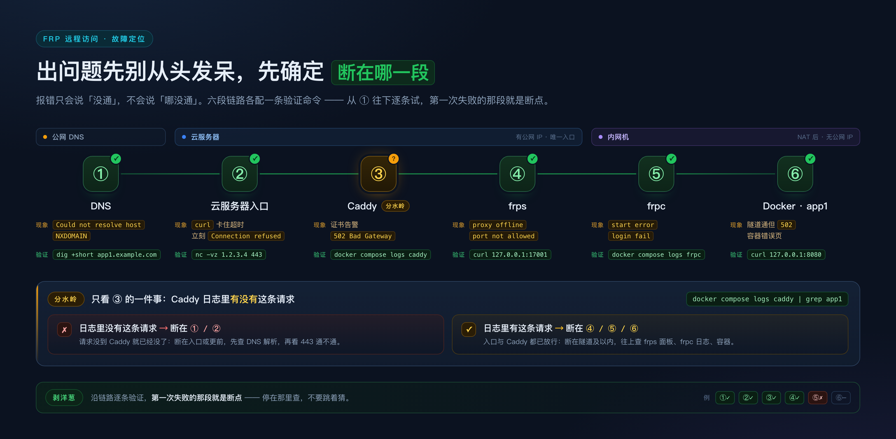

# 05 · 打不开了？按链路分段排查

> 报错只说「没通」，不说「哪没通」。这篇把链路切成六段，
> 你只做一件事：**先确定断在哪一段**，再谈原因。
>
> 每节都是「现象 → 定位命令 → 原因 → 修复」，命令可以直接复制。
> 前提是按 [03](03-部署手册.md) 装好过；变量名见 [README](README.md) §2。
>
> 三条纪律：**一次只改一处**；**先判断断点，再猜原因**；
> **README §3 的表和现场对不上时，先修现场再对齐表**。

```bash
# 先把变量备好，全文命令直接用
export DOMAIN_ROOT=example.com
export SERVER_IP=1.2.3.4
export APP_HOST=app1.${DOMAIN_ROOT}
export DEPLOY_ROOT=/opt/frp
export FRPS_BIND_PORT=7000
export REMOTE_PORT=17001
export LOCAL_PORT=8080
export FRPS_DASH_PASSWORD="<frps 面板密码>"
export FRPC_DASH_PASSWORD="<frpc 面板密码>"
export INNER_SSH=home
```



## 0. 30 秒快速定位

| 现象 | 断在哪 | 一句话验证 | 章节 |
|---|---|---|---|
| `Could not resolve host` / `NXDOMAIN` | DNS | `dig +short ${APP_HOST}` | §1 |
| `curl` 卡住，几十秒后 `timed out` | 云服务器入口 | `nc -vz ${SERVER_IP} 443` | §2.1 |
| 立刻 `Connection refused` | 端口没人监听 | `ss -lntp \| grep -E ':(80\|443)'` | §2.2 |
| 返回云厂商提示页，**Caddy 日志里没有这条请求** | 入口拦截（多为备案） | `curl -sS http://${APP_HOST}/ \| head -20` | §2.3 |
| 证书告警，证书名不是这个域名 | Caddy / ACME | `openssl s_client -connect ...` | §3.1 |
| `502 Bad Gateway` | Caddy 活着、后端不通 | 服务器上 `curl 127.0.0.1:${REMOTE_PORT}` | §3.3 |
| `502` 且 Dashboard 里该 proxy `offline` | frpc | Dashboard「代理」页 | §4.2、§5 |
| 域名通了，但返回容器错误页 / 连接被拒 | Docker | 内网机上 `curl 127.0.0.1:${LOCAL_PORT}` | §6 |

**剥洋葱脚本**：一条条往下走，**第一次失败的那条就是断点**。全过说明问题在应用自己身上，不在链路。

```bash
dig +short ${APP_HOST}                                                   # ① DNS
nc -vz ${SERVER_IP} 443                                                  # ② 入口：443 能不能连
curl -sSI --resolve ${APP_HOST}:443:${SERVER_IP} https://${APP_HOST}/    # ② 入口：TLS + HTTP（绕过 DNS）
ssh root@${SERVER_IP} "cd ${DEPLOY_ROOT} && docker compose logs --since 2m caddy | tail -20"   # ③ Caddy 收到没
ssh root@${SERVER_IP} "curl -sS -o /dev/null -w '%{http_code}\n' http://127.0.0.1:${REMOTE_PORT}/"   # ④ frps 隧道口
```

③ 是分水岭：**Caddy 日志里有这条请求** → 断在隧道及以内（§4–§6）；**没有** → 断在入口或更前（§1、§2）。

## 1. DNS 层

### 1.1 域名根本解析不出来（含泛解析没生效）

**现象**：`curl: (6) Could not resolve host`；浏览器 `DNS_PROBE_FINISHED_NXDOMAIN`。

```bash
dig +short ${APP_HOST}                 # 空 → 记录不存在
dig +short test123.${DOMAIN_ROOT}      # 空 → 泛解析没配 / 没生效
dig ${APP_HOST} +trace | tail -15      # 哪一级权威服务器回的 NXDOMAIN
nslookup ${APP_HOST} 8.8.8.8           # 换解析器复核，排除本地 DNS
```

**原因**：A 记录没加；主机记录填成了完整域名（`app1.example.com` 而不是 `app1`）；泛解析 `*` 指错。
**修复**：加 `app1.${DOMAIN_ROOT} A ${SERVER_IP}`，或修好泛解析；不想等 TTL 就用 §0 的 `--resolve` 先验链路。

### 1.2 解析到旧 IP / 本地地址（TTL 缓存）

```bash
dig +short ${APP_HOST} @1.1.1.1        # 公共 DNS 结果，和本地对比
grep -n "${APP_HOST}" /etc/hosts       # 本机有没有劫持
dig ${APP_HOST} AAAA                   # 有无 IPv6 记录（v6 不通会让客户端先超时）
```

**原因**：TTL 未过期；hosts 有旧条目；个别 DNS 服务商把不存在的子域解析到广告页。
**修复**：等 TTL；清缓存（macOS `sudo dscacheutil -flushcache; sudo killall -HUP mDNSResponder`，Linux
`sudo resolvectl flush-caches`）。排查期一律用 §0 的 `--resolve` 命令绕 DNS。

## 2. 云服务器入口层

### 2.1 连接超时（`curl` 卡住不回包）

```bash
nc -vz ${SERVER_IP} 443 ; nc -vz ${SERVER_IP} ${FRPS_BIND_PORT}      # 从外网测
ssh root@${SERVER_IP} 'ss -lntp | grep -E ":(80|443)\b"'             # 服务器上真在听吗
ssh root@${SERVER_IP} 'sudo ufw status verbose'                      # 本地防火墙
```

**原因**：安全组没放行（最常见）；`ufw`/`firewalld` 拦了；服务绑在 `127.0.0.1` 而非 `0.0.0.0`；
`SERVER_IP` 变了。**修复**：安全组入站放行 `22`/`80`/`443`/`${FRPS_BIND_PORT}`，`ufw` 同理：
`sudo ufw allow 80/tcp && sudo ufw allow 443/tcp && sudo ufw allow ${FRPS_BIND_PORT}/tcp`

> **Docker 与 ufw 的坑**：Docker 发布端口时会往自己的 `DOCKER` 链插规则，**绕过 ufw 的 INPUT 规则**，
> 所以「`ufw status` 是 deny、端口照样能访问」正常。要限制容器端口，规则写进 `DOCKER-USER` 链。

### 2.2 立刻 `Connection refused`（含 frpc 连不上 frps 的同类问题）

```bash
ssh root@${SERVER_IP} 'ss -lntp | grep -E ":(80|443)\b"'
ssh root@${SERVER_IP} "cd ${DEPLOY_ROOT} && docker compose ps"
ssh root@${SERVER_IP} "cd ${DEPLOY_ROOT} && docker compose logs --tail 50 caddy"
```

**原因**：Caddy 没起 / 起在别的端口 / 只绑回环 / 容器重启循环；frpc 那侧则是 frps 没跑或 `bindPort` 填错。
**修复**：按日志修 Caddy 启动错误，确认真在监听 `0.0.0.0:443`；frpc 侧先确认 frps 在听且端口对外可达。

### 2.3 80/443 被拦截：返回提示页，Caddy 日志却是空的

```bash
curl -sS -D- http://${APP_HOST}/ -o /tmp/resp.html ; head -c 300 /tmp/resp.html
ssh root@${SERVER_IP} "cd ${DEPLOY_ROOT} && docker compose logs --since 5m caddy | tail -5"
```

**原因**：国内服务器 + 域名未备案，运营商/云厂商在入口直接拦截，请求**根本到不了 Caddy**；判据就是
Caddy 有没有日志：没有 = 没到你这儿，改 Caddyfile 纯属白费。**修复**：备案后再用 80/443；备案没下来想验
链路，临时让 Caddy 额外监听非标准端口（如 `:17443`）并单独放行，验完撤掉——不要当长期方案。

## 3. Caddy 层

### 3.1 证书没签下来

**现象**：浏览器证书错误；`curl` 报 `SSL certificate problem`；证书里是别的域名或 Caddy 自签。

```bash
ssh root@${SERVER_IP} "cd ${DEPLOY_ROOT} && docker compose logs --since 10m caddy | grep -iE 'acme|tls|certificate|error'"
openssl s_client -connect ${SERVER_IP}:443 -servername ${APP_HOST} </dev/null 2>/dev/null \
  | openssl x509 -noout -subject -issuer -dates
```

| 日志关键词 | 原因 |
|---|---|
| `challenge failed` / `connection refused` | 80/443 外部不可达，或安全组只开了 443 |
| `no such host` / `no valid A records found` | DNS 没生效，ACME 找不到这个域名 |
| `too many failed authorizations` | 反复重启 Caddy 撞上失败验证上限（5 次/域名/小时） |

**修复**：先 `dig` 确认解析、`nc` 确认 80/443 都通；撞速率限制只能等（或先用 staging CA 联调）；只验证
链路不要真证书时，临时给站点加 `tls internal`。

### 3.2 `caddy reload` 失败

```bash
ssh root@${SERVER_IP} "cd ${DEPLOY_ROOT} && docker compose exec -T caddy caddy validate \
  --config /etc/caddy/Caddyfile --adapter caddyfile"
ssh root@${SERVER_IP} "cd ${DEPLOY_ROOT} && docker compose exec -T caddy caddy reload \
  --config /etc/caddy/Caddyfile --adapter caddyfile && echo OK"
ssh root@${SERVER_IP} "cd ${DEPLOY_ROOT} && docker compose exec -T caddy head -40 /etc/caddy/Caddyfile"
```

**原因**：Caddyfile 语法错（少 `}`、`reverse_proxy` 后没地址）；80/443 被占；改的文件不是容器实际加载的
那份（挂载路径不对）。**修复**：`validate` 会报行号，修到通过再 reload；用第三条确认容器内内容。

### 3.3 `502 Bad Gateway`

**这是全场信息量最大的报错：Caddy 活着，它连不上 `reverse_proxy` 指向的地址。**

```bash
ssh root@${SERVER_IP} "cd ${DEPLOY_ROOT} && docker compose logs --since 2m caddy | grep -iE 'dial|502' | tail"
ssh root@${SERVER_IP} "curl -v http://127.0.0.1:${REMOTE_PORT}/ 2>&1 | tail -5"
```

日志通常是 `dial tcp 127.0.0.1:17001: connect: connection refused`。

| 原因 | 判断 | 修复 |
|---|---|---|
| frpc 没在跑这条 proxy | Dashboard 里 `offline` | §4.2、§5.2 |
| `remotePort` 写错（表里 17001，Caddyfile 写了 17011） | 对着 README §3 核 | 改 Caddyfile + reload |
| frpc 的 `localPort` 填错，隧道通了后端没人 | 隧道端口也 refused | §5.3 |
| frps 刚重启，或 17xxx 没发布到宿主回环 | Dashboard 短暂离线 / `ss` 无该端口 | 等几秒；补 compose 端口发布 |

**动手前先做这一步**：服务器上 `curl 127.0.0.1:${REMOTE_PORT}`——通了问题在 Caddy，不通就别去改 Caddyfile。

### 3.4 日志怎么看

```bash
ssh root@${SERVER_IP} "cd ${DEPLOY_ROOT} && docker compose logs -f --since 1m caddy"   # 含 ACME、反代错误
ssh root@${SERVER_IP} "cd ${DEPLOY_ROOT} && docker compose logs caddy | grep -c ' 502 '"
```

Caddy 默认**没有** access log。要看按请求的访问日志，在 `Caddyfile` 的全局块里配 `log { output stdout }`，
再 `validate` + `reload`。

## 4. frps 层

### 4.1 Dashboard 打不开

```bash
ssh -N -L 7500:127.0.0.1:7500 root@${SERVER_IP}   # 保持这个终端
curl -sI http://127.0.0.1:7500/                  # 另开一个终端
```

浏览器再访问 `http://127.0.0.1:7500`。**原因**：Dashboard 只发布到宿主回环是**设计如此**（compose 里
`127.0.0.1:7500:7500`），`http://${SERVER_IP}:7500` 打不开才正常。**不要**改成公网可达——它只有单账号
Basic Auth。**修复**：用 SSH 隧道。

### 4.2 proxy 在线状态是 `offline`

```bash
ssh root@${SERVER_IP} 'curl -s -u "admin:${FRPS_DASH_PASSWORD}" \
  http://127.0.0.1:7500/api/v2/proxies' | head -c 400
```

**原因**：`offline` = 注册过、现在没活的客户端在跑：frpc 掉了、配置里删了、或名字冲突。删掉 proxy 后
frps 会留一条 `offline` 历史记录，看到老名字不代表没删干净。**修复**：去 frpc 侧查（§5）；判断「是否真
占着端口」只看**在线**那条。

### 4.3 `start error: port not allowed`

```bash
ssh root@${SERVER_IP} "grep -n -A5 allowPorts ${DEPLOY_ROOT}/frps/frps.toml"
ssh root@${SERVER_IP} "cd ${DEPLOY_ROOT} && docker compose logs --tail 50 frps | grep -i allow"
```

**原因**：`frps.toml` 配了 `allowPorts`（模板是 `{ start = 17000, end = 17199 }`），新 `remotePort` 不在范围内。
**修复**：换回范围内端口，或放宽 `allowPorts` 后**重启 frps**——没有热加载，所有隧道瞬断几秒。这是硬
边界不是建议值：范围外一律拒绝。

### 4.4 token 不匹配

```bash
ssh root@${SERVER_IP} "cd ${DEPLOY_ROOT} && docker compose logs --since 5m frps | grep -iE 'auth|token' | tail"
ssh root@${SERVER_IP} "grep -n 'auth.token' ${DEPLOY_ROOT}/frps/frps.toml"
ssh ${INNER_SSH} "grep -n 'auth.token' ~/frp/frpc.toml"
```

**原因**：两边不一致——最常见不是「完全不同」，而是多了空格、包了引号、复制时带了换行，或一边改了另一边
没重启。**修复**：`openssl rand -hex 16` 生成同一个值，两边改完都重启容器。
**frps 自己起不来**：看 `docker compose logs --tail 80 frps` 第一条错误（`bindPort` 被占、TOML 语法错），
`docker compose exec -T frps frps verify -c /etc/frp/frps.toml` 做纯语法校验。

## 5. frpc 层

### 5.1 连不上 frps

**现象**：`connect to server error` / `i/o timeout` / `connection refused`；Dashboard 看不到客户端。

```bash
ssh ${INNER_SSH} 'cd ~/frp && docker compose logs --tail 50 frpc'
ssh ${INNER_SSH} "nc -vz ${SERVER_IP} ${FRPS_BIND_PORT}"
```

**原因**：安全组没放行 `bindPort`；`serverAddr`/`serverPort` 填错；frps 没跑；内网机断网。
**修复**：先用 §2.2 确认 frps 在听且端口对外可达，再回来查 `~/frp/frpc.toml`。

### 5.2 proxy `start error`

```bash
ssh ${INNER_SSH} 'cd ~/frp && docker compose logs --tail 100 frpc | grep -iE "start error|error"'
```

| 日志 | 原因 | 修复 |
|---|---|---|
| `port already used` | frps 上已有**在线** proxy 占了同一 `remotePort` | 换号；或下线冲突那条（04 §3） |
| `port not allowed` | 被 `allowPorts` 拒绝 | §4.3 |
| `proxy name already in use` | 同一 frps 上有重名 proxy（含 `user` 前缀后的名字） | 改名 |
| `connect to local service error` | frpc 的 `localIP/localPort` 连不上后端 | §5.3 |

### 5.3 `localIP` / `localPort` 填错（最高频）

**现象**：Dashboard 显示 proxy **online**，但服务器上 `curl 127.0.0.1:${REMOTE_PORT}` 是 refused 或挂住
——隧道通了，「最后一公里」没通。

```bash
ssh ${INNER_SSH} 'ss -lntp | grep '"${LOCAL_PORT}"'
ssh ${INNER_SSH} "curl -v --max-time 3 http://127.0.0.1:${LOCAL_PORT}/ 2>&1 | tail -5"
ssh ${INNER_SSH} 'curl -s -u "admin:${FRPC_DASH_PASSWORD}" http://127.0.0.1:7400/api/status'
```

**原因**（按频率）：① 填了**容器名**（Docker DNS 只在容器网络内有效）；② 填 `localhost` 而应用只听
IPv6 的 `::1`；③ 应用没发布端口（§6.2）；④ 容器内只绑回环（§6.3）；⑤ frpc 不是 `network_mode: host`。
**修复**：`localIP = "127.0.0.1"` + `localPort = <应用 compose 发布到宿主的端口>`（README §4 硬规则 1）。

## 6. Docker 层

### 6.1 容器根本没起

```bash
ssh ${INNER_SSH} 'cd ~/apps && docker compose ps -a'
ssh ${INNER_SSH} 'cd ~/apps && docker compose logs --tail 80'
ssh ${INNER_SSH} "docker inspect -f '{{.State.ExitCode}} {{.State.Error}}' app1"
```

**原因**：镜像拉不下来；启动参数报错；挂载目录不存在或没权限；端口被占。`Restarting` 循环说明进程起来就退。
**修复**：按日志第一条错误修。

### 6.2 端口没发布到宿主

```bash
ssh ${INNER_SSH} 'docker port app1'
ssh ${INNER_SSH} "docker inspect -f '{{json .HostConfig.PortBindings}}' app1"
```

**原因**：`~/apps/docker-compose.yaml` 里写了 `expose:`（只在容器网络内可见）而**没写** `ports:`；或宿主
端口没映射对。**修复**：补 `ports: ["127.0.0.1:${LOCAL_PORT}:80"]`，`docker compose up -d` 重建。
**宿主端口被占**（`ss -lntp | grep ${LOCAL_PORT}` 有输出）：旧容器没删或另一项目发布了同一端口，`down` 后重建。

### 6.3 容器内只监听 `127.0.0.1`，宿主不可达（最隐蔽）

**现象**：宿主 `curl 127.0.0.1:${LOCAL_PORT}` refused，但 `docker exec app1 curl -sI http://127.0.0.1:80` 通。

```bash
ssh ${INNER_SSH} 'docker exec app1 ss -lntp'                      # 监听 0.0.0.0 还是 127.0.0.1？
ssh ${INNER_SSH} 'docker exec app1 hostname -i'                   # 拿容器 IP
ssh ${INNER_SSH} 'docker exec app1 curl -sI http://<容器IP>:80'   # 用容器 IP 再试一次
```

**原因**：`ss` 里只有 `127.0.0.1:80`，说明应用只绑了**容器自己的回环**。Docker 的端口发布是把流量
DNAT 到**容器网卡**的，容器回环上的监听收不到——「容器内能访问、宿主不能」正是这个原因。
**修复**：让应用绑 `0.0.0.0`（`listen 0.0.0.0:80`、`--bind 0.0.0.0`，按应用而定）。**不要**用
`network_mode: host` 绕——会和宿主抢端口，也会和别的容器冲突。

> 同一条规则在 `frps.toml` 里也踩过：容器内绑 `127.0.0.1` 时宿主连不上，真正该收窄的是**端口发布**（§4.1）。

## 7. 常用诊断命令速查

| 想确认什么 | 命令 | 在哪台机器 |
|---|---|---|
| 谁在监听端口 | `ss -lntp \| grep <端口>` | 服务器 / 内网机 |
| 域名解析到哪 | `dig +short ${APP_HOST}` | 任意 |
| 容器状态 / 日志 | `cd ~/apps && docker compose ps -a` / `... logs -f --tail 100` | 内网机 |
| frpc 日志 | `cd ~/frp && docker compose logs -f frpc` | 内网机 |
| frps 日志 | `cd ${DEPLOY_ROOT} && docker compose logs -f frps` | 云服务器 |
| Caddy 日志 | `cd ${DEPLOY_ROOT} && docker compose logs -f caddy` | 云服务器 |
| Caddy 配置校验 | `cd ${DEPLOY_ROOT} && docker compose exec -T caddy caddy validate --config /etc/caddy/Caddyfile --adapter caddyfile` | 云服务器 |
| Dashboard | `ssh -N -L 7500:127.0.0.1:7500 root@${SERVER_IP}`，再开 `http://127.0.0.1:7500` | 云服务器 |
