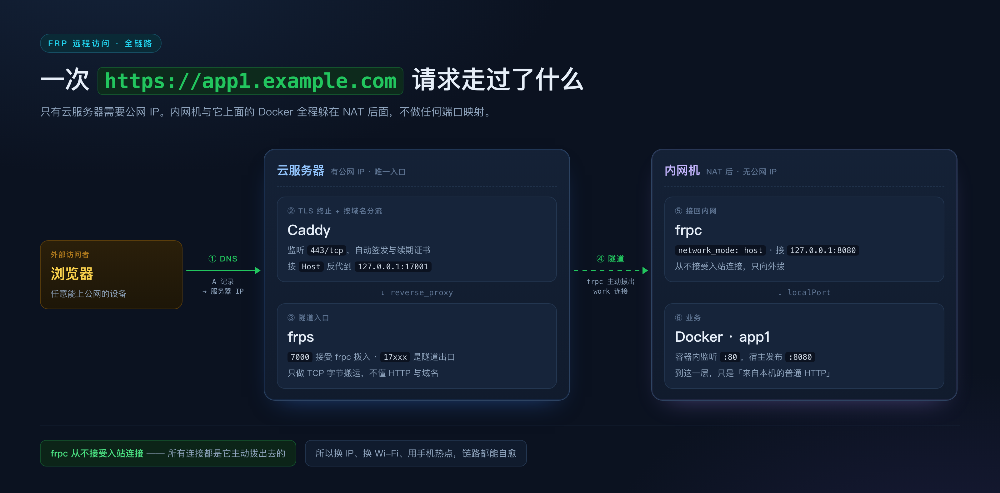

# 用域名访问家里内网机上的应用

> **读完这套文档，你会得到什么：**
> 给内网机上任意一个 Docker 应用绑一个 `https://app1.example.com` 这样的地址，
> 人在外面用手机或笔记本直接打开——证书正常、不用连 VPN、不用装任何客户端。
>
> 需要准备的东西很少：一个域名、一台最便宜的云服务器、一台常年开着的内网机。
> 内网机不需要公网 IP，家里的路由器也不用做任何端口映射。

---

## 0. 先看懂链路，再动手

```
浏览器
  │ ① DNS: app1.example.com → 云服务器公网 IP
  ▼
云服务器（有公网 IP）
  │ ② 443/tcp 进 Caddy，Caddy 自动签好 Let's Encrypt 证书
  │ ③ Caddy 按 Host 把请求反代到 127.0.0.1:17001
  ▼
frps（云服务器上，只做 TCP 转发）
  │ ④ 收到连接 → 通知 frpc「有活干」
  ▼
frpc（内网机上，主动拨出的隧道）
  │ ⑤ 转发到 127.0.0.1:8080（或容器名:端口）
  ▼
Docker 容器（真正跑应用的地方）
```



**为什么这样就能通？** 整条链路里只有云服务器有公网 IP。内网机和它上面的 Docker
都躲在 NAT 后面——因为 frpc 的所有连接都是**由内向外主动拨出**的，从不由外向内建立。
所以它不需要端口映射、不需要动态域名，换 Wi-Fi、换 IP、用手机热点，都会自动重连。

---

## 1. 你需要准备什么

| 需要 | 说明 |
|---|---|
| 一个域名 | 建议开泛解析 `*.example.com`，以后加应用不用每次等 DNS 生效 |
| 一台云服务器 | Linux（Ubuntu 22.04 / Debian 12 都行），1 核 1G 足够，能装 Docker + Compose v2 |
| 一台内网机 | 常年开着，Linux 或 Windows + WSL2，装了 Docker |
| SSH 访问 | 能连上云服务器和内网机（建议给内网机在 `~/.ssh/config` 里起个别名） |

> **国内云服务器必须先备案**，否则 80/443 会被拦截——这是合规问题，技术上绕不过去。

---

## 2. 参数表：把下面这些换成你自己的值

后面所有文档、所有配置都引用同名的变量。先填好这张表，再看别的。

| 变量 | 示例 | 你的值 | 说明 |
|---|---|---|---|
| `DOMAIN_ROOT` | `example.com` | | 主域名，建议配泛解析 `*.example.com` |
| `SERVER_IP` | `1.2.3.4` | | 云服务器公网 IP（A 记录指向它） |
| `FRPS_BIND_PORT` | `7000` | | frpc 连 frps 的端口，**必须对公网开放** |
| `FRPS_TOKEN` | `<32位随机串>` | | frps / frpc 共享密钥，两边必须完全一致 |
| `FRPS_DASH_PORT` | `7500` | | frps 管理面板，**只绑回环**，通过 SSH 隧道访问 |
| `FRPS_DASH_PASSWORD` | `<16位随机>` | | frps 面板 admin 密码 |
| `FRPC_DASH_PORT` | `7400` | | frpc 本机管理接口，**只绑回环** |
| `FRPC_DASH_PASSWORD` | `<16位随机>` | | frpc 面板 admin 密码 |
| `TUNNEL_PORT_BASE` | `17000` | | 隧道端口段起点；规划 `17000–17999`，实际启用 `17000–17199` |
| `INNER_SSH` | `home` | | `~/.ssh/config` 里给内网机起的别名 |
| `INNER_LAN_IP` | `192.168.1.50` | | 内网机的局域网 IP（仅排查时用） |
| `DEPLOY_ROOT` | `/opt/frp` | | 云服务器上的部署根目录 |

> token 用 `openssl rand -hex 16` 生成。
> 真实值只写在你自己的机器上，别提交进 Git——文件里带 token 就等于带钥匙。

---

## 3. 端口与域名分配表：整套方案的地图

这张表是整套方案的出生证明：左边是别人访问的域名，右边是容器里的服务。
**新增一个应用 = 在表里加一行 + 改两个文件**（`Caddyfile` 和 `frpc.toml`）。

| # | 域名 | 公网入口 | Caddy 反代目标 | frps `remotePort` | 内网机 `localPort` | Docker 服务 |
|---|---|---|---|---|---|---|
| 1 | `app1.${DOMAIN_ROOT}` | `443/tcp` | `127.0.0.1:17001` | `17001` | `127.0.0.1:8080` | `app1`（容器 80） |
| 2 | `app2.${DOMAIN_ROOT}` | `443/tcp` | `127.0.0.1:17002` | `17002` | `127.0.0.1:9000` | `app2`（容器 80） |
| 3 | `web.${DOMAIN_ROOT}` | `443/tcp` | `127.0.0.1:17003` | `17003` | `127.0.0.1:3000` | `web`（容器 3000） |
| — | `ssh.${DOMAIN_ROOT}`（可选） | `22/tcp` | 不经 Caddy，直接 TCP | `17022` | `127.0.0.1:22` | SSH 服务本身 |

**端口段约定**（照抄即可，不容易撞）：

| 段 | 用途 |
|---|---|
| `7000` | frps `bindPort` |
| `7500` | frps Dashboard（仅回环） |
| `17000–17099` | HTTP/HTTPS 类应用（Caddy 反代到这些端口） |
| `17100–17199` | 纯 TCP 应用（数据库、SSH、游戏服等） |
| `17200–17299` | 预留 / 实验 |

---

## 4. 三条硬规则（踩过才知道）

这三条决定了 90% 的故障，动手前先记住：

1. **`localIP` / `localPort` 必须是 frpc 那台机器能访问到的地址。**
   Docker 里的服务，从宿主看是 `127.0.0.1:发布端口`；
   从容器网络看是 `服务名:容器端口`。选错就是「隧道通了但 502」。

2. **Caddy 的 `reverse_proxy` 指向 `127.0.0.1:<remotePort>`，不是容器。**
   Caddy 与 frps 同机，走回环最安全；别让 Caddy 去访问 Docker 网络里的容器名。

3. **改 `frps.toml` 必须重启 frps，所有隧道会瞬断几秒。**
   frp 没有热加载。改完要接受这个代价，并知道 frpc 会在几秒内自动重连。

---

## 5. 日常怎么维护

整套方案的全部操作，就是改三个文件、重载一个服务：

| 要做什么 | 改哪个文件 | 怎么生效 | 影响面 |
|---|---|---|---|
| 加 / 改应用隧道 | 内网机 `~/frp/frpc.toml` | `docker compose up -d frpc` | 该 frpc 的所有隧道短暂断开 |
| 加 / 改域名 | 云服务器 `${DEPLOY_ROOT}/caddy/Caddyfile` | `caddy reload` | **不断隧道** |
| 改 frps 行为 | 云服务器 `${DEPLOY_ROOT}/frps/frps.toml` | 重启 frps | **所有隧道瞬断数秒** |

全程手工改配置文件，不依赖任何图形工具。先把手工链路跑通，
再用你喜欢的图形界面去编辑同样的文件——出问题时你才知道该看哪一层。

---

## 6. 怎么读这套文档

**第一次搭**：先花 5 分钟扫一眼 [02 目录结构](02-目录结构.md)，
再照 [03 部署手册](03-部署手册.md) 从上到下做——它是主线，每一步都有验收命令。

之后按需查：加应用看 [04](04-新增应用.md)，打不开看 [05](05-故障排查.md)，
想搞懂原理看 [01](01-全链路原理.md)。**不读 01 一样能搭通**，读了你会更少踩坑。

| 篇 | 讲什么 | 什么时候看 |
|---|---|---|
| [01 原理与选型](01-全链路原理.md) | 每一跳在干什么、三种方案的取舍 | 想理解「为什么」时 |
| [02 目录结构](02-目录结构.md) | 两台机器上文件放哪、哪些必须备份 | 动手前扫一眼 |
| [03 部署手册](03-部署手册.md) | 从零部署，每步都有验收命令 | 第一次搭建 |
| [04 新增应用](04-新增应用.md) | 加一个应用的六步 + 怎么干净下线 | 每加一个新服务 |
| [05 故障排查](05-故障排查.md) | 按链路分段定位，先确定断在哪一段 | 访问不通时 |

---

## 关于这份文档

**它是什么**：一份可以直接照做的部署笔记——从配 DNS 到 `curl` 通，每一步都有验收命令。

**它不是什么**：

- 不是软件，不提供 frps / frpc 安装包；
- 不是 frp 官方文档，frp 本身的配置项以 [gofrp.org](https://gofrp.org/zh-cn/docs/) 为准；
- 不是安全加固方案，只讲「怎么把内网服务暴露到公网」这条链路。

**版本时效**：文中锁定 `fatedier/frps:v0.71.0` 与 `fatedier/frpc:v0.71.0`，是写作时的版本。
升级前先看官方 release notes，确认配置格式有没有变。

**风险提示**：这套方案会把内网服务暴露到公网，请务必守住三条——

- 只暴露确实需要暴露的端口；frps Dashboard（`7500`）与 frpc admin（`7400`）一律只绑回环；
- `auth.token` 用强口令、定期更换；
- 不要把数据库、内网管理后台这类不该出现在公网的东西挂上去。

**许可证**：[MIT](LICENSE) —— 文档与图片可自由使用、修改、转载。
